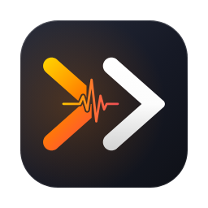
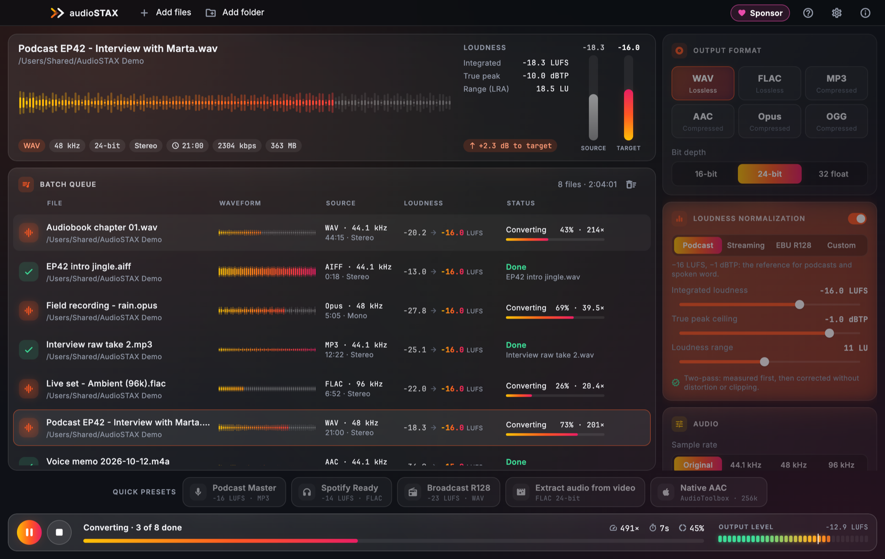
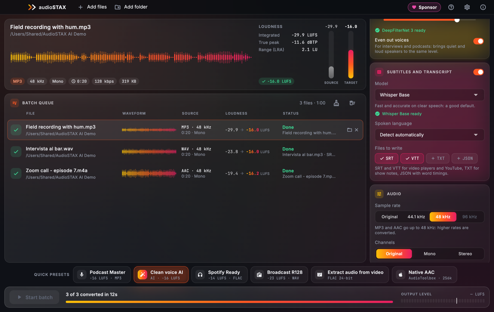
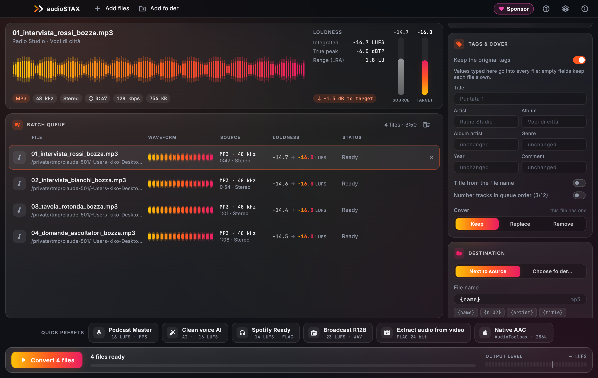
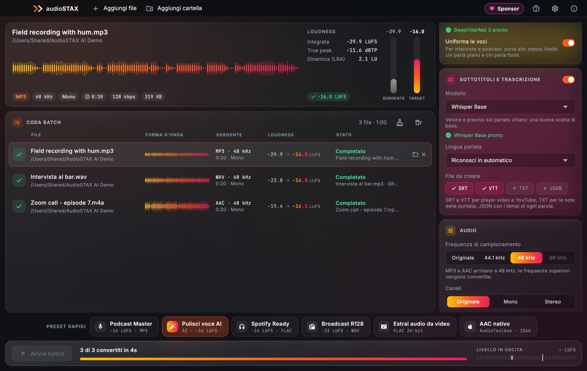
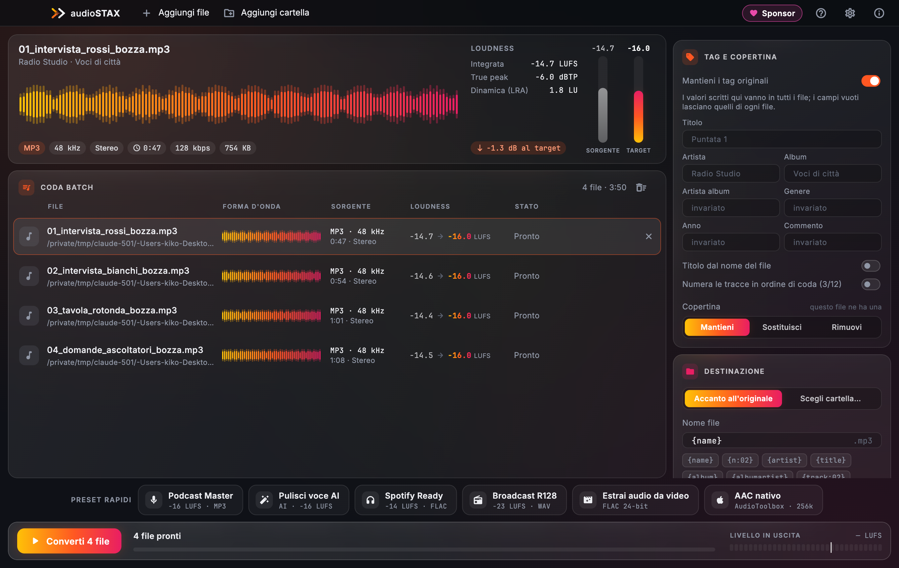
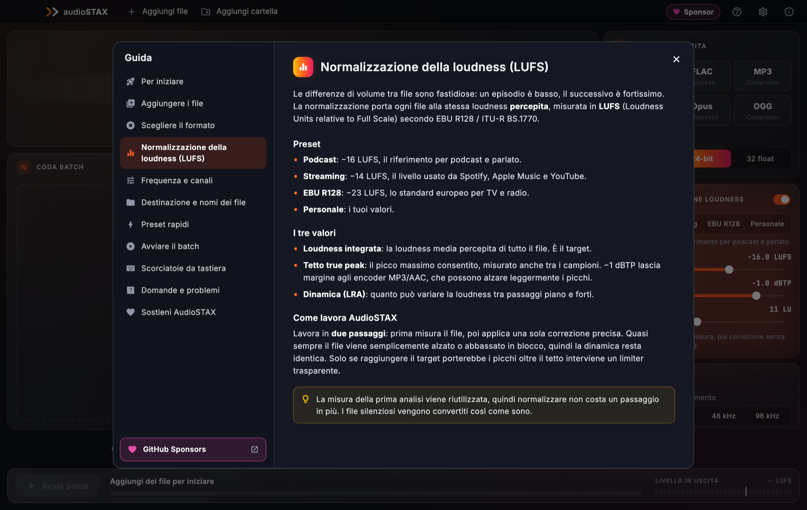

<h1 align="center">AudioSTAX</h1>

<b>Batch audio studio — convert, normalize to LUFS and clean up hundreds of files at once.</b> 
100% offline · no subscriptions · macOS · Windows · Linux

<a href="#english">English</a> · <a href="#italiano">Italiano</a>

▶ <a href="video/audiostax-tour-en.mp4"><b>Watch AudioSTAX at work</b></a> (1 min, English) · ▶ <a href="video/audiostax-tour-it.mp4"><b>Guarda AudioSTAX al lavoro</b></a> (1 min, italiano)

---

## English

AudioSTAX takes a folder of recordings, songs or videos and gives you back files that are all **in the format you need and at the same loudness** — podcast-ready, streaming-ready or broadcast-ready — in a few seconds. Everything happens on your computer: nothing is uploaded.

### What it does

- **Batch conversion** to WAV (16/24/32-bit float), FLAC, MP3 (CBR/VBR), AAC (.m4a), Opus and OGG Vorbis — from almost any audio format and from the soundtrack of MP4, MOV, MKV, WebM and AVI videos.
- **Loudness normalization in LUFS** (EBU R128 / ITU-R BS.1770), two-pass: one precise gain correction that keeps your dynamics, with a true-peak ceiling. Presets for **podcasts (−16)**, **streaming (−14)** and **broadcast (−23)**, or your own values.
- **Speech cleanup for whole batches**: AI noise reduction (DeepFilterNet) for fans, traffic and noisy rooms, a light mode for faint hiss, automatic removal of 50/60 Hz mains hum, and a leveler that evens out quiet and loud voices.
- **Subtitles and transcripts** with Whisper, written next to every converted file: SRT and VTT for players and YouTube, TXT for show notes, JSON with word timings. Language detected automatically.
- **Apple AudioToolbox AAC** on macOS: Apple's own encoder, excellent quality with almost no CPU.
- **See before you convert**: waveform, format, sample rate, duration and measured loudness of every file, with the gain needed to reach the target.
- **Fast**: several files at once on all your cores, typically 20–100× faster than real time. Pause, resume or stop at any moment; progress in the Dock or taskbar.
- **Safe**: originals are never touched, files are written under a temporary name and renamed only when complete, existing files are renamed, overwritten or skipped as you choose.
- **Tags and cover art for the whole batch**: type an artist, album, year or genre once and it goes into every file; title from the file name, track numbers in queue order (1/12, 2/12…). Keep, replace or remove the cover art (MP3, FLAC and AAC).
- **File names your way**: variables like `{n:02} {artist} - {title}`, find-and-replace rules and letter case, with a live preview of the final names that warns about files already there.
- **Five languages**: English, Italiano, Deutsch, Español, Français, with a complete built-in guide (F1).

### Download

| System | File | Notes |
|---|---|---|
| **macOS** 12+ (Apple Silicon) | `AudioSTAX-v<version>-macOS.dmg` | open the DMG and drag AudioSTAX to Applications |
| **Windows** 10/11 (x64) | `AudioSTAX-v<version>-Windows-x64-Setup.exe` | installs for your user, no administrator rights |
| | `AudioSTAX-v<version>-Windows-x64.zip` | portable: unzip and run `audiostax_ui.exe` |
| **Linux** (x86_64) | `AudioSTAX-v<version>-Linux-x86_64.AppImage` | `chmod +x` and run |
| | `audiostax_<version>_amd64.deb` | Debian, Ubuntu, Mint: `sudo apt install ./audiostax_<version>_amd64.deb` |
| | `audiostax-<version>-1.x86_64.rpm` | Fedora, openSUSE: `sudo dnf install ./audiostax-<version>-1.x86_64.rpm` |
| | `AudioSTAX-v<version>-Linux-x86_64.tar.gz` | unpack anywhere and run `AudioSTAX/audiostax_ui` |

All files are on the **[Releases page](https://github.com/kikoz85/audioSTAX/releases/latest)**, with their SHA-256 checksums.

### First launch

- **macOS** — AudioSTAX is not yet signed with an Apple certificate. Right-click the app in Applications → **Open** → **Open**. If macOS still refuses: **System Settings → Privacy & Security → Open Anyway**.
- **Windows** — if SmartScreen shows “Windows protected your PC”, click **More info → Run anyway**.
- **Linux** — the AppImage needs FUSE (`libfuse2` on older distributions); without it run `./AudioSTAX-*.AppImage --appimage-extract-and-run`.

### How to use it

▶ [A one-minute video](video/audiostax-tour-en.mp4) shows every screen: adding files, the inspector, a batch with speech cleanup and subtitles, settings and the guide.

1. **Add** files or whole folders: drag them onto the window or use **Add files / Add folder** (⌘O / Ctrl+O).
2. **Choose** the result in the panel on the right — format, loudness target, sample rate, channels, destination and file name — or click a **quick preset** at the bottom:
   - **Podcast Master** — MP3 192 kbps, 44.1 kHz, −16 LUFS
   - **Clean voice AI** — AI noise removal, even voices, MP3 −16 LUFS
   - **Spotify Ready** — FLAC 24-bit, 44.1 kHz, −14 LUFS
   - **Broadcast R128** — WAV 24-bit, 48 kHz, −23 LUFS
   - **Extract audio from video** — lossless FLAC of the soundtrack
   - **Native AAC** — AAC 256 kbps with Apple AudioToolbox
3. **Convert** with the orange button (⌘↩ / Ctrl+Enter). Double-click a finished row to show the file.

The built-in **guide (F1)** explains every option, LUFS, formats and file-name variables in detail.

### FAQ

- **Does it need the internet?** Only once, to download the AI models you choose (8 MB for noise reduction, 32–574 MB for subtitles). Everything else runs offline and no audio ever leaves your computer.
- **Why is my file called “name (1)”?** A file with that name already exists (often the original, when converting to the same format in the same folder). Pick another folder, change the name with a variable or choose *Overwrite*.
- **A very short clip stays quieter than the target.** Clips under about 3 seconds cannot be measured reliably and are converted without forcing the level; the same for digital silence.
- **Which FFmpeg does it use?** Its own build, included in the app: LGPL, audio only, with no GPL or non-free parts.

### Support AudioSTAX

AudioSTAX is free, with no ads and no subscriptions. If it saves you time, you can support it on **[GitHub Sponsors](https://github.com/sponsors/kikoz85)**: sponsorships pay for code-signing certificates (no more warnings on first launch), test machines for the three systems and the time for new features.

You can also find the **♥ Sponsor** button in the app's toolbar. Starring this repository and telling other creators about AudioSTAX helps too.

---

## Italiano

AudioSTAX prende una cartella di registrazioni, brani o video e te li restituisce **nel formato che ti serve e tutti allo stesso volume percepito** — pronti per il podcast, per lo streaming o per la messa in onda — in pochi secondi. Tutto avviene sul tuo computer: niente viene caricato online.

### Cosa fa

- **Conversione batch** in WAV (16/24/32-bit float), FLAC, MP3 (CBR/VBR), AAC (.m4a), Opus e OGG Vorbis — da quasi ogni formato audio e dalla colonna sonora di video MP4, MOV, MKV, WebM e AVI.
- **Normalizzazione della loudness in LUFS** (EBU R128 / ITU-R BS.1770) a due passaggi: una sola correzione di guadagno precisa che conserva la dinamica, con tetto true peak. Preset per **podcast (−16)**, **streaming (−14)** e **broadcast (−23)**, oppure valori tuoi.
- **Pulizia della voce su interi batch**: riduzione del rumore con AI (DeepFilterNet) per ventole, traffico e stanze rumorose, una modalità leggera per il fruscio, rimozione automatica del ronzio di rete a 50/60 Hz e uniforma voci che pareggia voci basse e alte.
- **Sottotitoli e trascrizioni** con Whisper, scritti accanto a ogni file convertito: SRT e VTT per player e YouTube, TXT per le note dell'episodio, JSON con i tempi di ogni parola. Lingua riconosciuta in automatico.
- **AAC Apple AudioToolbox** su macOS: l'encoder di Apple, qualità eccellente con la CPU quasi a riposo.
- **Vedi prima di convertire**: forma d'onda, formato, frequenza, durata e loudness misurata di ogni file, con il guadagno necessario per arrivare al target.
- **Veloce**: più file insieme su tutti i core, di solito 20–100 volte più veloce del tempo reale. Pausa, ripresa o stop in qualsiasi momento; avanzamento nel Dock o nella barra delle applicazioni.
- **Sicuro**: gli originali non vengono mai toccati, i file vengono scritti con un nome temporaneo e rinominati solo a lavoro finito, i file esistenti vengono rinominati, sovrascritti o saltati come preferisci.
- **Tag e copertina per tutto il batch**: scrivi una volta artista, album, anno o genere e finiscono in tutti i file; titolo dal nome del file, numeri di traccia nell'ordine della coda (1/12, 2/12…). Copertina mantenuta, sostituita o rimossa (MP3, FLAC e AAC).
- **Nomi dei file come vuoi tu**: variabili come `{n:02} {artist} - {title}`, regole trova e sostituisci e maiuscole/minuscole, con l'anteprima dei nomi finali che avvisa se un file esiste già.
- **Cinque lingue**: italiano, inglese, tedesco, spagnolo e francese, con una guida completa integrata (F1).

### Download

| Sistema | File | Note |
|---|---|---|
| **macOS** 12+ (Apple Silicon) | `AudioSTAX-v<versione>-macOS.dmg` | apri il DMG e trascina AudioSTAX in Applicazioni |
| **Windows** 10/11 (x64) | `AudioSTAX-v<versione>-Windows-x64-Setup.exe` | si installa per il tuo utente, senza diritti di amministratore |
| | `AudioSTAX-v<versione>-Windows-x64.zip` | portabile: estrai e avvia `audiostax_ui.exe` |
| **Linux** (x86_64) | `AudioSTAX-v<versione>-Linux-x86_64.AppImage` | `chmod +x` e avvia |
| | `audiostax_<versione>_amd64.deb` | Debian, Ubuntu, Mint: `sudo apt install ./audiostax_<versione>_amd64.deb` |
| | `audiostax-<versione>-1.x86_64.rpm` | Fedora, openSUSE: `sudo dnf install ./audiostax-<versione>-1.x86_64.rpm` |
| | `AudioSTAX-v<versione>-Linux-x86_64.tar.gz` | estrai dove vuoi e avvia `AudioSTAX/audiostax_ui` |

Tutti i file sono nella **[pagina Releases](https://github.com/kikoz85/audioSTAX/releases/latest)**, con i relativi checksum SHA-256.

### Primo avvio

- **macOS** — AudioSTAX non è ancora firmato con un certificato Apple. Clic destro sull'app in Applicazioni → **Apri** → **Apri**. Se macOS rifiuta ancora: **Impostazioni di Sistema → Privacy e sicurezza → Apri comunque**.
- **Windows** — se SmartScreen mostra “PC protetto da Windows”, clicca **Ulteriori informazioni → Esegui comunque**.
- **Linux** — l'AppImage richiede FUSE (`libfuse2` sulle distribuzioni più vecchie); senza, avviala con `./AudioSTAX-*.AppImage --appimage-extract-and-run`.

### Come si usa

▶ [Un video di un minuto](video/audiostax-tour-it.mp4) mostra tutte le schermate: aggiunta dei file, l'inspector, un batch con pulizia della voce e sottotitoli, impostazioni e guida.

1. **Aggiungi** file o intere cartelle: trascinali sulla finestra o usa **Aggiungi file / Aggiungi cartella** (⌘O / Ctrl+O).
2. **Scegli** il risultato nel pannello a destra — formato, target di loudness, frequenza, canali, destinazione e nome del file — oppure clicca un **preset rapido** in basso:
   - **Podcast Master** — MP3 192 kbps, 44,1 kHz, −16 LUFS
   - **Pulisci voce AI** — rumore tolto con l'AI, voci uniformate, MP3 −16 LUFS
   - **Spotify Ready** — FLAC 24-bit, 44,1 kHz, −14 LUFS
   - **Broadcast R128** — WAV 24-bit, 48 kHz, −23 LUFS
   - **Estrai audio da video** — FLAC lossless della colonna sonora
   - **AAC nativo** — AAC 256 kbps con Apple AudioToolbox
3. **Converti** con il pulsante arancione (⌘↩ / Ctrl+Invio). Doppio clic su una riga completata per mostrare il file.

La **guida integrata (F1)** spiega nel dettaglio ogni opzione, i LUFS, i formati e le variabili dei nomi.

### Domande frequenti

- **Serve internet?** Solo una volta, per scaricare i modelli AI che scegli (8 MB per la riduzione del rumore, da 32 a 574 MB per i sottotitoli). Tutto il resto funziona offline e nessun audio lascia mai il computer.
- **Perché il mio file si chiama “nome (1)”?** Esiste già un file con quel nome (spesso l'originale, se converti nello stesso formato nella stessa cartella). Scegli un'altra cartella, cambia il nome con una variabile oppure seleziona *Sovrascrivi*.
- **Una clip molto breve resta più bassa del target.** Sotto i 3 secondi circa la misura non è affidabile e il file viene convertito senza forzare il livello; lo stesso per il silenzio digitale.
- **Quale FFmpeg usa?** Il suo, incluso nell'app: LGPL, solo audio, senza parti GPL o non libere.

### Sostieni AudioSTAX

AudioSTAX è gratuito, senza pubblicità e senza abbonamenti. Se ti fa risparmiare tempo, puoi sostenerlo su **[GitHub Sponsors](https://github.com/sponsors/kikoz85)**: le sponsorizzazioni pagano i certificati di firma (niente più avvisi al primo avvio), le macchine di test per i tre sistemi e il tempo per le nuove funzioni.

Trovi il pulsante **♥ Sponsor** anche nella barra in alto dell'app. Anche una stella a questo repository e il passaparola tra creator aiutano.

---

© 2026 Enrico Fanucchi · <a href="https://www.enricofanucchi.com">www.enricofanucchi.com</a> 
AudioSTAX is free software under its own <a href="LICENSE.txt">license</a>; third-party components are listed in <a href="THIRD_PARTY_LICENSES.txt">THIRD_PARTY_LICENSES.txt</a>.

